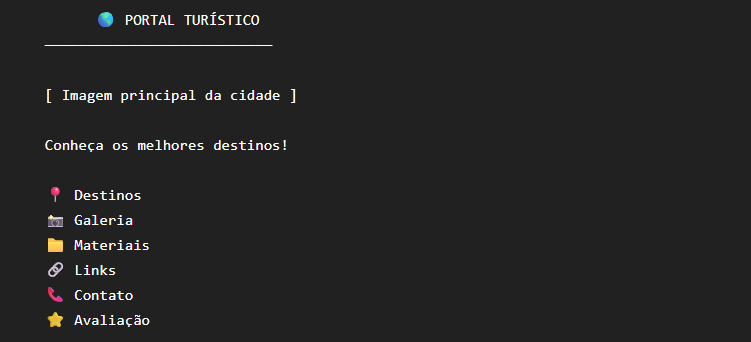

# Atividade 14 - Streamlit

## Página inicial — app.py

A página inicial deverá apresentar:
- Nome do portal;
- Logo;
- Imagem principal;
- Pequena descrição da cidade;
- Uma mensagem de boas-vindas;

## Menu lateral.
O menu lateral deve conter os seguintes itens:
- 📍 Destinos
- 📷 Galeria
- 📁 Materiais
- 🔗 Links
- 📞 Contato
- ⭐ Avaliação